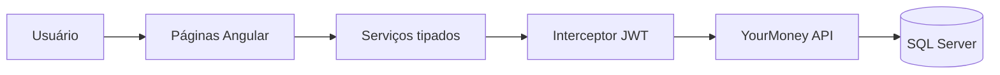

# YourMoney Web

Interface web do **YourMoney**, uma aplicação de gestão financeira pessoal que ajuda a acompanhar receitas, despesas, investimentos e metas em um único painel.

Este repositório contém o frontend em Angular. A API está em [YourMoney](https://github.com/juanvecco/YourMoney).

## Principais recursos

- cadastro, login e rotas protegidas por autenticação;
- dashboard mensal com resumo e gráfico financeiro;
- gestão de receitas e despesas;
- parcelamento de despesas com prévia das parcelas;
- receitas e despesas recorrentes;
- classificação de receitas e acompanhamento de reembolsos;
- carteira de investimentos;
- criação e acompanhamento de metas mensais;
- organização por contas e categorias;
- interface responsiva com estados de carregamento, vazio e erro.

## Fluxo da aplicação



## Tecnologias

- Angular 20 com componentes standalone
- TypeScript 5.8
- RxJS
- Angular Router, Forms e HttpClient
- Chart.js
- Angular Material e Bootstrap Icons
- SweetAlert2
- SCSS
- Jasmine e Karma
- Docker

## Estrutura do projeto

```text
src/app/
├── components/      # páginas e funcionalidades por domínio
├── guards/          # proteção de rotas autenticadas
├── interceptors/    # envio do token JWT
├── models/          # contratos tipados
├── navegacao/       # home, menu e rodapé
└── services/        # comunicação com a API
```

## Executando localmente

### Pré-requisitos

- [Node.js 22](https://nodejs.org/)
- API [YourMoney](https://github.com/juanvecco/YourMoney) disponível em `https://localhost:5001`

### 1. Clone e instale as dependências

```bash
git clone https://github.com/juanvecco/YourMoney-angular.git
cd YourMoney-angular
npm ci
```

### 2. Inicie o servidor de desenvolvimento

```bash
npm start
```

Acesse `http://localhost:4200`. O endereço da API é definido em `src/environments/environment.ts`.

> O frontend servido pela API em `https://localhost:5001` e o servidor Angular em `http://localhost:4200` usam origens diferentes. Por isso, cada origem mantém seu próprio `localStorage` e pode exigir um novo login.

## Build e testes

```bash
npm run build
npm test -- --watch=false --browsers=ChromeHeadless
```

Os testes cobrem componentes, guards, interceptor, serviços e regras de apresentação financeira.

## Docker

```bash
docker compose up --build
```

A aplicação ficará disponível em `http://localhost:4200`.

## Backend

A API REST, autenticação, persistência e regras de negócio estão no repositório [juanvecco/YourMoney](https://github.com/juanvecco/YourMoney).

## Status

Projeto em evolução contínua, usado para desenvolver e demonstrar uma solução full stack de finanças pessoais.
